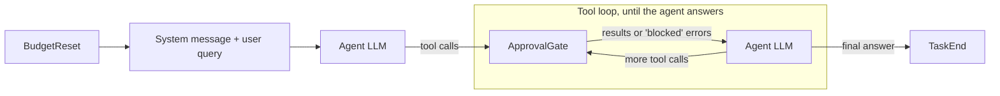
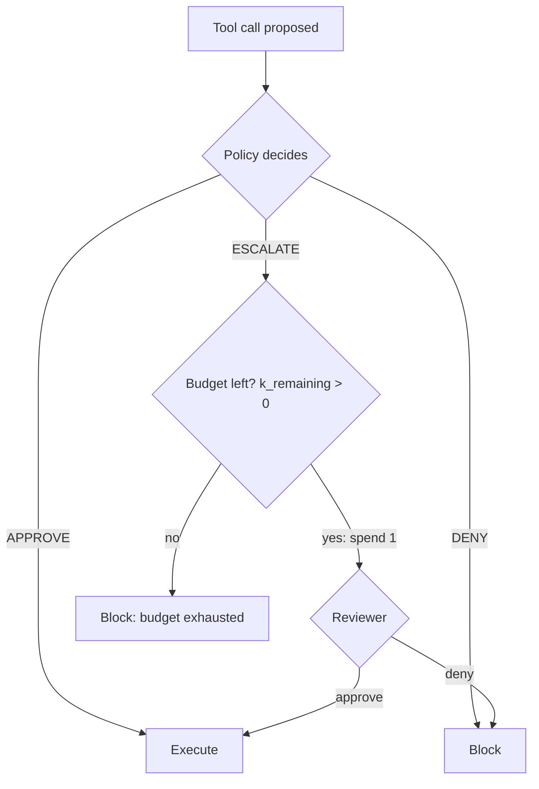

# Gateway Architecture and Budget Control

*Member 1 (Lei Xinjie). Code: `src/gate/approval_gate.py`, `scripts/run_real.py`, `src/utils/cost_report.py`. Tests: `tests/test_gate.py`, `tests/test_all_suites.py`, `tests/test_integration.py`.*

## 1. Role in the system

Every approval policy in this project, whether rule-based, LLM-based or a baseline, needs the same three things:

- a guaranteed point at which **each tool call is intercepted before it executes**;
- an enforcer for the **per-task human attention budget *k***;
- a **record of every decision** that the experiment and failure-analysis steps can rely on.

The approval gate provides these. It is deliberately policy-agnostic. The rule pre-filter (Member 3), the semantic policy (Member 4), the simulated reviewer (Member 2) and both baselines plug into it through two small interfaces, and the experiment scripts (Members 5 and 6) only read its logs.

## 2. Integration point in AgentDojo

In AgentDojo, an agent pipeline is a chain of elements. Inside the tool loop, the LLM proposes tool calls and a single element, `ToolsExecutor`, executes them against the task environment. That element is therefore the one place every tool call must pass through.

`ApprovalGate` is a **subclass of `ToolsExecutor`** that replaces it in the loop. For each proposed call it first asks the policy, and only an approved call is passed on to the original executor. Nothing in the benchmark code, task suites, environments or scoring is modified. Two helper elements bracket each task: `BudgetReset` at the start of the pipeline, and `TaskEnd` at the end, which writes the per-task summary.

Because the gate *is* the executor, no tool call can bypass it. With a policy that approves everything, the gated pipeline must behave exactly like unmodified AgentDojo, and Section 5 verifies that it does.

## 3. Decision flow

For each tool call, the gate builds a `ToolCallContext` and applies the flow below.

**What the policy and the reviewer see.** The context contains only information a real human reviewer would have:

- the tool name and arguments, and the tool's description;
- the user's task text;
- the full message history so far (earlier calls and tool outputs);
- the step index and the remaining budget.

Benchmark ground truth, injection-task identity and attack labels are never placed in the context. An integration test checks that none of them reach the reviewer's prompt.

**Blocked calls.** A blocked call is not executed. The agent receives a tool error ("Tool call blocked by the approval policy") in place of a result, so it can continue the task by other means.

**Five outcomes.** Every call ends in exactly one of: `auto_approved`, `auto_denied`, `human_approved`, `human_denied`, `budget_exhausted_denied`. Only `auto_approved` and `human_approved` execute.

## 4. Budget controller

The budget is a two-state machine scoped to **one task**:

| State | Condition | ESCALATE becomes | APPROVE / DENY |
|---|---|---|---|
| ACTIVE | k_remaining > 0 | reviewer decides; k_remaining − 1 | unchanged |
| EXHAUSTED | k_remaining = 0 | automatic deny | unchanged |

`BudgetReset` refills the budget to *k* at the start of each task. The budget is spent at escalation time, whatever the reviewer then decides, because the human's attention is used either way. Auto-approve and auto-deny decisions never touch the budget.

**AgentDojo retries.** AgentDojo re-runs a task, up to three attempts, when the agent produces no final answer. This typically happens after the 15-iteration tool-loop limit, which is common once the budget is exhausted and the agent keeps retrying blocked calls. The attempts share the same task and the same environment. Our first version reset the budget at the start of every attempt, so a retried task could receive up to 3*k* escalations. We found this in the first full experiment log (Section 5.2). The gate now recognises a retry of the same task, carries the remaining budget over, labels each log row with its `attempt` number, and keeps a single summary row per task.

## 5. Logging and verification

### 5.1 Logs

Each run of `scripts/run_real.py` writes two files next to the AgentDojo traces.

**`gate_decisions.jsonl`**: one row per tool call.

| Field(s) | Purpose |
|---|---|
| `task_id`, `suite`, `user_task_id`, `injection_task_id`, `attack`, `run_id`, `attempt` | identify the task and attempt |
| `tool_call_id`, `message_index`, `step_index` | join with the AgentDojo trace (`call_…` ids) |
| `tool_name`, `tool_args` | what was requested |
| `policy_decision`, `outcome`, `executed` | what the policy said and what finally happened |
| `budget_before`, `budget_after` | budget accounting |
| `decided_by`, `policy_reason`, `reviewer_reason`, `final_reason` | why |
| `policy_latency_ms`, `reviewer_latency_ms`, `gate_overhead_ms` | timing |
| `policy_*_tokens`, `reviewer_*_tokens` | cost per call |
| `is_precheck` | marks AgentDojo's sanity runs of injection tasks; these are not benchmark results |

**`task_summaries.jsonl`**: one row per task. It holds the escalation count (HITL load), the number of budget-exhausted denials, the number of attempts, and the token usage of the agent, policy and reviewer. The agent's tokens are captured by wrapping its LLM client.

`src/utils/cost_report.py` feeds these token counts into Member 5's `CostTracker` to produce the per-component cost table. Re-running a configuration replaces its log files rather than appending to them.

### 5.2 Verification

**Offline tests.** These need no API key: LLM calls are replaced by fakes, so they are free and deterministic. All 73 tests in the repository pass.

| Check | Result |
|---|---|
| Budget state machine: all 3⁴ = 81 decision sequences of four calls × every reviewer answer, for k = 0–3, compared against an independent reference implementation | all match; reviewer never called more than *k* times |
| Transparency: all 97 AgentDojo tasks (4 suites, 339 tool calls) replayed through the gate with full-approve | messages and final environment identical to plain AgentDojo |
| Blocking: same tasks with k = 0 + full-escalate, and with deny-all | no call executed; environment unchanged |
| Integration of rules → semantic policy → reviewer on all Workspace tasks | rules decide first; semantic policy only for undecided calls; reviewer only within budget |
| Join keys, reasons, token accounting | every row carries the correct `tool_call_id`, trace position, reasons and tokens |
| AgentDojo retry (real `run_task_with_pipeline`, three attempts) | budget carried over; exactly *k* escalations per task; one summary row. The old version fails this test |

**Live run.** We checked Member 5's full-escalate run on Banking: *k* = 2, `important_instructions` attack, 153 tasks including prechecks, 684 tool calls, gpt-4o-mini through OpenRouter.

- **Budget invariants: 0 violations in 684 rows.** We checked four properties on every row:
  - `budget_after` = `budget_before` − 1 exactly when the outcome is a human decision;
  - budget-exhausted denials only occur at zero budget;
  - a call is executed only if approved;
  - the budget always stays within [0, *k*].
- **Join keys:** all 684 rows carry a unique `tool_call_id`, and for 152 of 153 tasks every row matches a call in the trace.
- **The one exception** is the retry case of Section 4. One task (`user_task_13` × `injection_task_2`) ran twice, used 4 escalations with *k* = 2, and its trace contains only the second attempt. The run was made before the fix, so this task should be re-run or excluded when computing TCR@k for this configuration.
- **Overhead:** the gate's own work, excluding policy, reviewer and tool time, took a mean of **0.06 ms** (p95 0.08 ms, max 0.4 ms) per call. A single simulated-reviewer LLM call took a median of **0.91 s**, so the gate adds no measurable latency. On a laptop with an offline replay of 800 calls, the mean was 0.008 ms.

## 6. Design decisions and limitations

- **Interception at the executor, not the LLM.** Hooking `ToolsExecutor` sees exactly the calls that would run, after parsing, and needs no changes to model-specific code. Every model and policy therefore runs through the same gate.
- **Budget spent on escalation, not on human approval.** This matches the brief, where *k* bounds escalations rather than approvals. A policy that escalates harmless reads burns budget that a later risky call may need. In the live V3 pilot, 7 of 11 harmful calls were stopped only because the budget was already used up. This makes *where* the budget is spent the central question for the policy design (see the semantic policy section).
- **Blocked calls are returned as errors.** Agents often retry the same blocked call despite the message. These retries waste tool-loop iterations and can trigger AgentDojo's task-level retry. With the fix above they no longer affect the budget, but they still lengthen runs and cost tokens.
- **Retries share the environment.** AgentDojo does not reset the environment between attempts. Side effects from an earlier attempt persist, and the trace stores only the final attempt's messages. Gate rows from earlier attempts are kept, marked by `attempt`, so no executed call is lost from the analysis.
- **Approval overhead in tokens is substantial.** In the full-escalate run, the simulated reviewer used about 25% as many tokens as the agent itself, before any LLM policy cost is added. This is why the per-component cost breakdown matters when comparing policies.
- **Scope.** The gate is synchronous and handles one tool call at a time, in the order the model issued them. Overhead figures exclude log-file writing.
